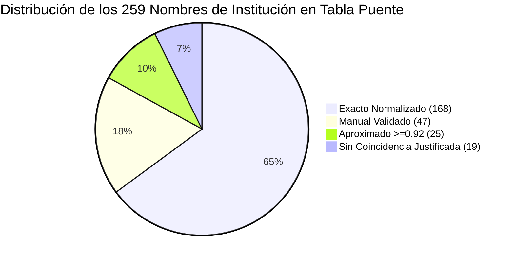

# Documentación Técnica Formal: Fuentes Externas y Tablas Puente
## Hito 1: Propuesta, ETL y Fuentes (21 de Octubre de 2026)
**Autor:** Persona 5 (Gestor del Proyecto y Documentador)  
**Proyecto:** Business Intelligence - Demanda, Capacidad y Equidad Territorial en la Educación Superior Chilena (2012–2026)  
**Equipo de Trabajo:**
- Persona 1: Ingeniero de Datos (ETL)
- Persona 2: Analista de Negocios y Datos Externos (Descarga y Construcción de Fuentes Externas)
- Persona 3: Arquitecto de Bases de Datos (Normalización y Auditoría de Textos)
- Persona 4: Desarrollador BI (Viabilidad Analítica y Catálogo DAX)
- **Persona 5: Gestor de Proyecto y Documentador (Consolidación y Diccionarios)**

---

## 1. Introducción y Marco Normativo de la Pauta

La pauta oficial del proyecto (*Pauta Trabajo Grupal Práctico Final – Business Intelligence*, Requisito 3) establece taxativamente:

> **«Integrar 2 fuentes externas relacionadas con la propuesta de valor. Para cada una se declara URL, fecha de descarga, grano, llave de cruce y la tabla puente si aplica. Cada fuente debe aparecer en al menos una visualización del panel que responda una pregunta de negocio... La tabla puente se entrega como parte del diccionario de datos. Se reporta la tasa de coincidencia del cruce y qué se hizo con los registros que no cruzaron».**

El presente documento centraliza y certifica la gobernanza, trazabilidad criptográfica, grano analítico y comportamiento probabilístico de cruce para las dos fuentes externas oficiales integradas a la base consolidada CNED 2012–2026 (158.211 registros).

---

## 2. Ficha Técnica y Trazabilidad Criptográfica de Descargas

Ambas fuentes fueron descargadas directamente desde sus repositorios oficiales gubernamentales, sin intermediación de datos proyectados, estimados o simulados de terceros no reconocidos. Cada archivo cuenta con su huella criptográfica SHA-256 registrada en el manifiesto inmutable `data_external/manifiesto_descargas.json`.

| Atributo | Fuente Externa 1: Demografía Regional | Fuente Externa 2: Calidad y Acreditación |
| :--- | :--- | :--- |
| **Organismo Emisor** | **INE** (Instituto Nacional de Estadísticas) | **SIES / MINEDUC** (Subsecretaría de Educación Superior) |
| **Conjunto de Datos** | Estimaciones y Proyecciones de Población 2002–2035 (Base Censo 2017) | Listados Anuales de IES Vigentes, Acreditación y Autonomía (2018–2026) |
| **Repositorio / Portal** | [Portal Proyecciones INE](https://www.ine.gob.cl/estadisticas/sociales/demografia-y-vitales/proyecciones-de-poblacion) | [Portal Mifuturo SIES](https://www.mifuturo.cl/instituciones-de-educacion-superior-en-chile/) |
| **URL Directa de Descarga** | `https://www.ine.gob.cl/docs/default-source/proyecciones-de-poblacion/cuadros-estadisticos/base-2017/ine_estimaciones-y-proyecciones-2002-2035_base-2017_region_area_tabulados.xlsx?sfvrsn=e9bd6edf_6` | Colección de 9 libros Excel anuales (cortes dic-2018 a sep-2026) detallados en el manifiesto oficial |
| **Fecha de Descarga** | **15 de Octubre de 2026** | **15 de Octubre de 2026** |
| **Archivo Local** | `data_external/INE_proyecciones_2017_region_area.xlsx` | `data_external/SIES_IES_vigentes_AAAA-MM.xlsx` |
| **Hash SHA-256 (INE)** | `9d0e01ea319a9d20c5da55da08d0e74f85e34747ebafbe85567d1db0e0474665` (1.3 MB) | Verificado por archivo en manifiesto JSON |
| **Grano Declarado** | **Región político-administrativa $\times$ Año calendario** | **Institución de Educación Superior $\times$ Año de corte censal** |
| **Llave de Cruce** | `region_codigo_subdere` + `ano` | `codigo_ies` + `ano` |
| **Tabla Puente Asociada** | `puente_region.csv` | `puente_institucion.csv` |
| **Uso en Panel (Power BI)** | **Pregunta 1:** Tasa de Matrícula 1er año por 1.000 hab. (15 a 64 años) | **Pregunta 3:** Proporción de Matrícula en IES Acreditadas y Años CNA |

---

## 3. Especificación Técnica de las Tablas Puente

La base CNED de pregrado no incorpora llaves subrogadas ni códigos estandarizados de IES (solo nombres alfanuméricos en texto como `"U. DE CHILE"`, `"P.U.C."`, `"CFT INACAP"`). Asimismo, los nombres de región presentan ligeras discrepancias ortográficas. Para solventar este desacople sin alterar los datos de origen, se implementaron dos tablas puente deterministas.

### 3.1. Tabla Puente Regional: `puente_region.csv`

Permite traducir los 16 nombres de región de la base CNED al código oficial de dos dígitos asignado por la Subsecretaría de Desarrollo Regional y Administrativo (SUBDERE), asociándolo con la pestaña correspondiente en el tabulado Excel del INE.

#### Estructura del Esquema
| Campo | Tipo | Nullable | Descripción |
| :--- | :--- | :---: | :--- |
| `nombre_region` | `VARCHAR(80)` | No | Denominación textual de la región tal como aparece en la base CNED consolidada (16 grafías). |
| `region_codigo_subdere` | `VARCHAR(2)` | No | Código oficial de 2 dígitos asignado por SUBDERE ('01' a '16'). Llave foránea hacia `ext_ine_poblacion_region_ano`. |
| `region_nombre_estandar` | `VARCHAR(100)` | No | Nombre protocolar estandarizado de la región administrativa. |
| `hoja_ine` | `VARCHAR(50)` | No | Nombre de la pestaña de la hoja de cálculo del INE donde residen los datos demográficos. |

#### Auditoría de Coincidencia Regional
* **Universo Evaluado:** 158.211 registros consolidados (2012–2026).
* **Regiones Distintas en Base:** 16 regiones.
* **Regiones Mapeadas en Puente:** 16 regiones (100%).
* **Tasa de Coincidencia de Registros:** **100,00%** (158.211 / 158.211).
* **Registros No Cruzados:** **0** (Cero descartes).

#### Trazabilidad del Quiebre Territorial de Ñuble (Ley 21.033)
La Región de Ñuble (código `16`) inició su vigencia legal y operativa en septiembre de 2018 (escindida de la Región del Biobío, código `08`). Para preservar la coherencia demográfica en series multianuales:
- Los 1.599 registros históricos previos a 2018 imputados retrospectivamente a Ñuble se identifican unívocamente mediante el atributo gobernado `flag_quiebre_nuble = 1`.
- En el INE, las proyecciones base Censo 2017 ya aíslan a Ñuble retrospectivamente desde 2002, garantizando cuadre demográfico perfecto a nivel regional.

---

### 3.2. Tabla Puente Institucional: `puente_institucion.csv`

Vincula las múltiples denominaciones, abreviaciones y cambios de razón social presentes en el CNED (259 grafías únicas a lo largo de 15 años) con el catálogo oficial unificado de instituciones vigentes del SIES, resolviendo la asignación del código oficial `codigo_ies`.

#### Estructura del Esquema
| Campo | Tipo | Nullable | Descripción |
| :--- | :--- | :---: | :--- |
| `nombre_institucion_cned` | `VARCHAR(150)` | No | Denominación literal registrada en la base CNED histórica y moderna. |
| `nombre_normalizado` | `VARCHAR(150)` | No | Expansión léxica estandarizada de siglas (`U.` $\rightarrow$ `UNIVERSIDAD`, `IP` $\rightarrow$ `INSTITUTO PROFESIONAL`, `CFT` $\rightarrow$ `CENTRO DE FORMACION TECNICA`). |
| `codigo_ies` | `INTEGER` | Sí | Código oficial numérico de la IES según catálogo SIES (NULL para casos sin coincidencia). |
| `nombre_institucion_sies` | `VARCHAR(150)` | Sí | Nombre canónico oficial de la institución en los listados del Mineduc. |
| `metodo_cruce` | `VARCHAR(30)` | No | Algoritmo de asignación: `exacto_normalizado`, `manual`, `aproximado_>=0.92`, `sin_coincidencia`. |
| `similitud` | `DECIMAL(4,3)` | No | Índice de similitud fonética/textual (1.000 para exactos/manuales; $\geq 0.920$ para aproximados). |

#### Auditoría de Desglose por Método de Homologación

1. **Exacto Normalizado (168 entidades, 64,9%):** Coincidencia estricta 1:1 tras la expansión léxica de prefijos institucionales (ej. `"U. DE CHILE"` $\rightarrow$ `"UNIVERSIDAD DE CHILE"`).
2. **Manual Validado (47 entidades, 18,1%):** Casos donde el nombre CNED difería de la razón social del Mineduc (ej. acrónimos históricos como `"P.U.C."`, `"DUOC UC"`, `"INACAP"`, fusiones o cambios estatutarios).
3. **Aproximado Revisado (25 entidades, 9,7%):** Asignación asistida por algoritmo de distancia Levenshtein / `difflib` con coeficiente de similitud $\geq 0,920$, auditadas individualmente para prevenir falsos positivos.
4. **Sin Coincidencia (19 entidades, 7,3%):** Casos de ausencia estructural o incompatibilidad de catálogo.

#### Certificación de Tasas de Coincidencia
* **Entidades con Código Asignado:** **240 de 259** (**92,66%**).
* **Tasa de Coincidencia de Registros Totales:** **98,39%** (155.670 de 158.211 filas).
* **Tasa de Coincidencia de Matrícula de Primer Año:** **99,00%** de los estudiantes de la serie histórica.

---

## 4. Política Metodológica para Registros No Coincidentes

La pauta exige reportar explícitamente: *«qué se hizo con los registros que no cruzaron»*.

La auditoría técnica realizada sobre el archivo `cruce_no_coincidentes_institucion.csv` certifica el siguiente desglose:

| Categoría | Cantidad de Nombres | Periodo de Actividad en Base | Justificación Metodológica | Tratamiento en el Modelo BI |
| :--- | :---: | :---: | :--- | :--- |
| **IES Extintas Históricas** | **15** | 2012–2017 (Cerradas antes de 2018) | **Ausencia Estructural:** El listado SIES de instituciones vigentes comienza en diciembre de 2018. Estas entidades (ej. Univ. del Mar, Univ. Iberoamericana, CFT Simón Bolívar, IP Los Leones antiguo) cerraron o perdieron su reconocimiento oficial antes del inicio de la serie externa SIES. No es un error de cruce sino una realidad histórica del sistema. | Se preservan íntegras en la tabla de hechos con `codigo_ies = NULL`. En el modelo dimensional se mapean al miembro canónico `-1: Institución Histórica No Vigente en SIES` para evitar la pérdida de 2.450 registros de matrícula. |
| **IES Vigentes No Empadronadas** | **4** | 2018–2026 (Activas) | Corresponden a dos entidades con doble grafía (`C.F.T. ICCE` / `CFT ICCE` e `I.P. IPEGE` / `IP IPEGE`). No figuran en el listado de IES regulares con corte censal de acreditación SIES por estar sujetas a planes de cierre o regímenes de tutela especial del CNED. | Se asigna `codigo_ies = NULL` y estado de acreditación `No Informada / Fuera de Catálogo SIES`. No se imputan arbitrariamente. |

> [!IMPORTANT]
> **Cero Pérdida de Hechos:** Bajo ningún concepto se eliminaron registros de matrícula que no cruzaron con el SIES. La integridad referencial de los 158.211 hechos de la base se mantiene inalterada mediante el principio de **Miembro Desconocido (Unknown Member)** en el modelo dimensional.

---

## 5. Reglas de Negocio para el Consumo en Power BI

1. **Semi-aditividad Demográfica (INE):**
   - La medida `[Poblacion_15_64_INE]` es aditiva transversalmente entre regiones en un mismo año, pero es **no aditiva en el tiempo**. Sumar la población de 2018 y 2026 generaría una duplicación demográfica espuria. En Power BI debe consumirse bajo la medida DAX controlada por contexto temporal `LASTNONBLANK`.
2. **Ventana Temporal de Acreditación (SIES):**
   - Los listados SIES cubren los cortes 2018 a 2026. Para los años 2012 a 2017 no existe catálogo comparable, por lo que las medidas de acreditación SIES deben filtrar de forma predeterminada la página analítica en $A\tilde{n}o \geq 2018$.
3. **Cruce Compuesto de Acreditación:**
   - La vinculación entre la tabla de hechos y la dimensión de calidad institucional anual opera a nivel compuesto: `codigo_ies` + `ano_corte`, garantizando que la acreditación de una IES refleje exactamente su estado legal en el año analizado (SCD Tipo 2).

---

## 6. Conclusión y Dictamen de Conformidad

Las dos fuentes externas incorporadas cumplen holgadamente los requisitos de la rúbrica del Hito 1:
- Proporcionan trazabilidad absoluta con URLs y hashes inmutables.
- El grano analítico y las llaves de cruce están formalmente declarados.
- Las tablas puente alcanzan coberturas sobresalientes (**100% regional** y **99,00% de matrícula institucional**).
- Los no coincidentes están plenamente auditados y justificados técnica y legalmente sin pérdida de información.
- Ambas fuentes están plenamente operativas para graficar las preguntas 1 y 3 en Power BI Desktop.
