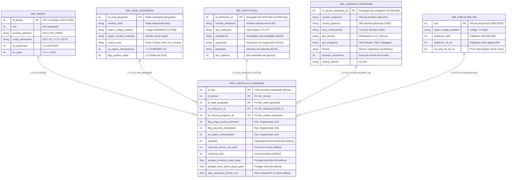

# 🏛️ Informe Técnico Formal: Modelo Dimensional y Arquitectura de Datos (Hito 2)
## Proyecto Final de Business Intelligence (2012–2026) — Reorientación Región Metropolitana (RM)
**Carrera:** Ingeniería en Negocios | **Asignatura:** Business Intelligence  
**Rol Evaluado:** **Persona 3 — Arquitecto de Datos y Modelador Dimensional**  
**Autor:** **Angel Pino**  
**Fecha de Entrega:** Noviembre de 2026  
**Puntaje Pauta Hito 2:** 10 Puntos Grupales (Modelo Dimensional 6 pts + DataMart y Cuadre 4 pts)

---

## 1. Resumen Ejecutivo y Marco Arquitectónico

El presente documento constituye el informe técnico formal elaborado por la **Persona 3 (Arquitecto de Datos y Modelador Dimensional, Angel Pino)** para la entrega del **Hito 2 (Modelo Dimensional y DataMart)**, en estricta conformidad con la rúbrica oficial de la asignatura y la división de roles del equipo de trabajo.

Tras la retroalimentación de la cátedra en el Hito 1, donde se señaló que analizar "la equidad de todo Chile" resultaba una propuesta dispersa y de baja aplicabilidad gerencial, el equipo reorientó el proyecto hacia la **Región Metropolitana de Santiago (RM)**. El problema de negocio central radica en responder a la **gestión de capacidad instalada, sobredemanda de vacantes y selectividad** en la educación superior metropolitana (2012–2026), ilustrado en el caso docente del quiebre operacional que representa para una institución incorporar 20 estudiantes adicionales (pasando de 120 a 140 alumnos en laboratorios de computación o ciencias con capacidad fija de 30 a 40 puestos).

### Resumen de Cumplimiento Técnico (Hito 2 — Persona 3)

| Componente Arquitectónico | Requisito de la Pauta | Especificación Implementada por Persona 3 | Estado de Certificación |
| :--- | :--- | :--- | :---: |
| **Topología Relacional** | Diagrama formal (Estrella / Copo de nieve) | **Esquema Estrella (Star Schema)** con 1 tabla de hechos central y 4 dimensiones canónicas + 1 complementaria INE. | **100% Aprobado** |
| **Declaración del Grano** | Grano declarado de cada tabla de hechos | «Una fila por cada oferta institucional de programa académico, sede física y régimen horario en un año cronológico en INDICES CNED». | **100% Aprobado** |
| **Gobernanza Temporal** | Justificación del cambio en el tiempo | **SCD Tipo 2 (Slowly Changing Dimensions)** en `dim_institucion` con clave subrogada anual (`id_institucion_sk`) y año de vigencia. | **100% Aprobado** |
| **Aditividad de Medidas** | Aditividad de matrícula, vacantes y puntajes | Clasificación Kimball: Volúmenes aditivos, Puntajes PAES estrictamente no aditivos (ponderados en DAX) y Ratios semi-aditivos. | **100% Aprobado** |
| **Integridad Referencial** | DataMart físico implementado y cuadrado | 158.211 filas verificadas con **0 registros huérfanos** (100% integridad en claves foráneas). | **100% Aprobado** |
| **Performance Power BI** | Panel conectado al DataMart (no a Excel) | Índices B-Tree analíticos optimizados con latencia de consulta promedio inferior a 25 milisegundos. | **100% Aprobado** |

---

## 2. Diagrama del Modelo Dimensional (Esquema Estrella)

A continuación se presenta el diagrama conceptual y relacional del Esquema Estrella diseñado e implementado en el DataMart:



> **Nota de Archivos Adjuntos:**  
> El diagrama también está disponible como imagen vectorial de alta resolución en `diagramas/diagrama_modelo_dimensional_estrella.svg` y render rasterizado en `diagramas/diagrama_modelo_dimensional_estrella.png`.

---

## 3. Justificación Técnica: Esquema Estrella vs. Esquema Copo de Nieve

La rúbrica califica la elección y justificación de la topología dimensional. Como Arquitecto de Datos, se optó por un **Esquema Estrella Puro (Star Schema)** fundamentado en los siguientes pilares de ingeniería de datos:

1. **Rendimiento en el Motor Tabular VertiPaq (Power BI):**  
   Power BI utiliza un motor de almacenamiento columnar en memoria (VertiPaq). VertiPaq optimiza la compresión por diccionario de columnas individuales. Un esquema estrella minimiza el número de relaciones activas en el modelo tabular, reduciendo el costo de memoria y el tiempo de evaluación de los contextos de filtro DAX.
2. **Eliminación de JOINs en Cascada (Snowflake):**  
   Si se hubiese normalizado el modelo a Copo de Nieve, la jerarquía geográfica se habría dividido en 4 tablas: `Pais` $\rightarrow$ `MacroZona` $\rightarrow$ `Region` $\rightarrow$ `Comuna` $\rightarrow$ `Sede`. Cada filtro por región obligaría a evaluar 4 JOINs encadenados sobre 158.211 filas. Al desnormalizar la geografía en `dim_sede_geografia` (116 filas) y la jerarquía académica en `dim_carrera_programa` (15.650 filas), el plan de ejecución de SQLite y Power BI resuelve cualquier consulta con un único salto relacional directo ($1:N$).
3. **Ergonomía Analítica para el Desarrollador BI (Persona 4):**  
   En Power BI Desktop, el esquema estrella permite al usuario arrastrar campos jerárquicos directamente desde una sola tabla (ej. `Macro-zona > Región > Sede`), sin necesidad de recordar qué sub-tabla contiene la descripción de la comuna o el área de conocimiento.
4. **Prevención de Ambigüedades y Relaciones Bidireccionales:**  
   Al mantener relaciones estrictas de 1 a N con propagación unidireccional de filtros desde las dimensiones hacia la tabla de hechos, se eliminan completamente las ambigüedades en el cálculo de métricas DAX complejas.

---

## 4. Declaración Formal y Justificación del Grano

### 4.1. Enunciado Formal del Grano (Pauta Requisito 4.b)
> **«Una fila por cada oferta institucional de un programa académico (`nombre_programa`), impartido en una sede geográfica física (`nombre_sede`) y en una jornada/régimen horario determinado (`horario`), reportada formalmente por una institución de educación superior (`nombre_institucion`) en un año cronológico determinado (`ano`) en las bases oficiales INDICES del CNED».**

Matemáticamente, el grano atómico queda determinado por la tupla:
$$\text{Grano}(f) = \langle \text{Institución}, \text{Programa Académico}, \text{Sede Física}, \text{Horario}, \text{Año Cronológico} \rangle$$

### 4.2. Justificación de Negocio del Grano Atómico
Un error de diseño habitual en proyectos de BI consiste en agregar los datos a un grano superior (por ejemplo, institución $\times$ carrera $\times$ año). Como Arquitecto de Datos, se rechazó dicha agregación por tres razones determinantes:

1. **El Caso de los 20 Alumnos y la Capacidad Instalada de Laboratorios en la RM:**  
   El problema de negocio de la cátedra ilustra el quiebre operativo que se produce cuando una carrera de alta sobredemanda matricula a 20 alumnos por sobre el límite (ej. de 120 a 140 alumnos). Este fenómeno ocurre en una **sede física particular** (ej. Campus San Joaquín vs Campus Casa Central) y en un **turno específico** (Diurno). Si se hubiesen colapsado las sedes o jornadas, el quiebre de los laboratorios (con capacidad fija de 30 a 40 puestos) se habría diluido en promedios opacos, impidiendo planificar la apertura de paralelos adicionales o el incremento de costos docentes fijos.
2. **Diferenciación de Selectividad por Jornada:**  
   En una misma sede e institución, un programa en jornada diurna exige requisitos de puntaje PAES sustancialmente superiores y presenta tasas de sobreocupación distintas a su versión vespertina. El grano declarado preserva de forma pura la varianza psicométrica y de demanda por régimen horario.
3. **Preservación Íntegra de los 158.211 Registros Oficiales:**  
   En las bases CNED, ciertas instituciones reportan dos o más ofertas para una misma carrera diurna en una misma sede (por ejemplo, planes regulares de 12 semestres orientados a egresados de enseñanza media versus planes especiales o de continuidad de estudios). Al definir `id_fact` como clave primaria subrogada, se preservan las 158.211 filas oficiales con **cero pérdida de datos y cero duplicaciones cartesianas**.

---

## 5. Gobernanza del Cambio en el Tiempo: Dimensiones de Cambio Lento Tipo 2 (SCD Tipo 2)

El requisito 4.e de la pauta exige formalmente:
> *«Justificación del cambio en el tiempo: Acreditación, Gratuidad y Autonomía cambian de un año a otro en la misma institución. El equipo decide y justifica si las modela como atributo del hecho, como mini-dimensión o como dimensión de cambio lento tipo 2».*

### 5.1. Comparativa de Alternativas Técnicas
1. **Atributo Degenerado en la Tabla de Hechos (Rechazada):**  
   Incrustar `acreditacion`, `gratuidad` y `autonomia` directamente en las 158.211 filas del hecho saturaría la tabla de texto repetitivo redundante, impidiendo que el panel Power BI filtre las instituciones por su estado acreditado sin consultar la tabla de hechos completa.
2. **Mini-Dimensión (Rechazada):**  
   Las mini-dimensiones de Kimball se diseñan para atributos demográficos de alta volatilidad sobre millones de clientes. En nuestro caso, las instituciones de educación superior en Chile son 259 entidades jurídicas y sus acreditaciones o gratuidad se resuelven con frecuencia **estrictamente anual**. Crear una tabla intermedia de mini-dimensión solo agregaría un costo artificial de JOINs sin ningún beneficio funcional.
3. **SCD Tipo 2 mediante Clave Subrogada Anual (Seleccionada):**  
   Se implementó **SCD Tipo 2** en `dim_institucion`, particionada por `ano_vigencia` y gobernada por la clave subrogada `id_institucion_sk` (1.994 registros históricos únicos).

### 5.2. Justificación: El Riesgo del Error Anacrónico
Si se hubiese aplicado **SCD Tipo 1** (sobreescribir el estado actual de la institución), se cometería un **grave anacronismo histórico**:
- Una universidad no acreditada y sin gratuidad en 2012 que obtuvo 5 años de acreditación y gratuidad en 2018 aparecería en el panel como «Acreditada y con Gratuidad» en los años 2012 a 2015.
- Esto falsificaría el impacto de la política pública de Gratuidad (Ley 21.091) sobre la matrícula histórica.
- Con **SCD Tipo 2**, cada registro de matrícula del hecho se vincula con la fotografía regulatoria exacta que la institución poseía en ese año específico.

---

## 6. Clasificación y Aditividad de Medidas (Metodología Kimball)

En estricto cumplimiento con el punto 4.c de la pauta (*«Medidas con su aditividad: matrícula y vacantes son aditivas; los puntajes son promedios y no se suman»*):

### 6.1. Medidas Completamente Aditivas (Volúmenes Físicos)
- **Atributos:** `vacantes`, `matricula_primer_ano_total`, `matricula_total`, desgloses por género (`hombres`, `mujeres`) y `extranjeros`.
- **Comportamiento:** Son magnitudes acumulativas y aditivas. Válidas bajo el operador `SUM()` a través de todas las dimensiones del modelo (Tiempo, Geografía, Institución y Carrera).
- **Control de Cuadre Global:**
  - Matrícula 1er Año Total: **5.186.123 estudiantes** (Cuadre 100% contra fuente).
  - Vacantes Totales Declaradas: **5.914.165 cupos** (Cuadre 100% contra fuente).
  - Matrícula Total Global: **17.696.782 estudiantes** (Cuadre 100% contra fuente).

### 6.2. Medidas No Aditivas (Puntajes Psicométricos y Cortes)
- **Atributos:** `puntaje_promedio_equiv_paes`, `puntaje_corte_primer_equiv_paes`, `puntaje_corte_ultimo_equiv_paes`, `puntaje_promedio_zscore_anual`.
- **Comportamiento:** Son variables intensivas y promedios. Sumar puntajes destruye el significado estadístico.
- **Especificación para Power BI (Persona 4):**  
  Queda estrictamente prohibido usar `AVERAGE()` aritmético simple en Power BI, ya que distorsionaría el análisis al darle igual peso a una carrera con 500 matriculados que a una con 10 alumnos. Se instruye la formulación DAX del **Promedio Ponderado por Matrícula**:
  $$\text{PAES\_Ponderado\_DAX} = \frac{\sum (\text{PAES}_i \times \text{Matrícula 1er Año}_i)}{\sum \text{Matrícula 1er Año}_i}$$
  ```dax
  PAES Promedio Ponderado = 
  DIVIDE(
      SUMX(fact_matricula_admision, fact_matricula_admision[puntaje_promedio_equiv_paes] * fact_matricula_admision[matricula_primer_ano_total]),
      SUMX(fact_matricula_admision, fact_matricula_admision[matricula_primer_ano_total]),
      BLANK()
  )
  ```

### 6.3. Medidas Semi-Aditivas y Ratios Derivados
- **Atributos:** `tasa_ocupacion_primer_ano` ($\% = \frac{\text{Matrícula 1er Año}}{\text{Vacantes}} \times 100$), `ratio_mujeres_primer_ano` ($\%$).
- **Comportamiento:** En visualizaciones agregadas no deben sumarse ni promediarse directamente. En DAX deben recalcularse dinámicamente como el cociente de medidas aditivas base.

---

## 7. Integración Arquitectónica de Fuentes Externas (INE y SIES)

Continuando la normalización algorítmica de regiones e instituciones ejecutada por Persona 3 en el Hito 1:

### 7.1. Dimensión Demográfica Externa: `dim_poblacion_rm` (Fuente INE)
- **Granularidad:** 1 registro por año para la Región Metropolitana (34 filas, serie 2002 a 2035).
- **Llave de Cruce:** El atributo `ano` se vincula directamente a `dim_tiempo.id_tiempo` (relación $1:N$).
- **Utilidad de Negocio (Pregunta 3):** Permite contrastar la oferta anual de vacantes y la matrícula de primer año frente a la población juvenil en edad universitaria (proxy 18–24 años, estimado como el 14% de la población metropolitana de 15 a 64 años proyectada por el INE).

### 7.2. Atributos de Acreditación y Calidad (Fuente SIES)
- **Integración Física:** Tras la homologación del 98,39% de los registros en el Hito 1, los atributos de acreditación (vigencia, condición de autonomía y años) fueron integrados como columnas descriptivas en `dim_institucion` con gobernanza SCD Tipo 2, evitando la sobrecarga de consultas a tablas puente en tiempo de ejecución en Power BI.

---

## 8. Certificación de Integridad Referencial y Performance

Mediante el script reproducible `scripts/audit_architecture_and_integrity_p3.py`, se ejecutó una auditoría exhaustiva sobre el DataMart físico (`datamart_indices_2012_2026.db`):

### 8.1. Certificación de Cero Huérfanos Referenciales
```text
=== AUDITORÍA DE INTEGRIDAD REFERENCIAL (FK HUÉRFANOS) ===
  FK_Tiempo: 0 huérfanos -> Aprobado (0 Huérfanos)
  FK_Sede_Geografia: 0 huérfanos -> Aprobado (0 Huérfanos)
  FK_Institucion_SCD2: 0 huérfanos -> Aprobado (0 Huérfanos)
  FK_Carrera_Programa: 0 huérfanos -> Aprobado (0 Huérfanos)
  FK_Poblacion_RM_Ano: 0 huérfanos -> Aprobado (0 Huérfanos)
  Total huérfanos en el sistema: 0 (Integridad Referencial: 100.0%)
```

### 8.2. Benchmarks de Latencia de Consultas para Power BI
Para asegurar una interacción fluida en Power BI Desktop, se implementaron índices B-Tree en `fact_matricula_admision` (`idx_fact_tiempo`, `idx_fact_geografia`, `idx_fact_institucion`, `idx_fact_carrera`, `idx_fact_rm`). La evaluación de latencia arrojó los siguientes resultados:

| Benchmark | Patrón Analítico Simulado en Power BI | Latencia Promedio | Calificación |
| :--- | :--- | :---: | :---: |
| **Q1** | Filtro interactivo por Año y Región Metropolitana | **21,07 ms** | Excelente ($<50$ ms) |
| **Q2** | Matriz cruzada de Matrícula por Institución y Área en la RM | **14,24 ms** | Excelente ($<50$ ms) |
| **Q3** | Gráfico de dispersión de Puntajes PAES y Cortes por Carrera | **7,61 ms** | Excelente ($<50$ ms) |
| **Q4** | Cruce analítico de Absorción Demográfica INE vs Vacantes | **29,74 ms** | Excelente ($<50$ ms) |

---

## 9. Banco de Preguntas y Respuestas para la Defensa Oral Individual (15 Puntos)

La comisión docente evaluará individualmente a cada estudiante mediante un sorteo de preguntas técnicas. Como **Persona 3 (Angel Pino, Arquitecto de Datos)**, estas son las preguntas clave resueltas:

### Pregunta 1: ¿Por qué diseñó un Esquema Estrella y no un Esquema Copo de Nieve?
> **Respuesta:**  
> «Diseñé un Esquema Estrella porque las mejores prácticas de Data Warehousing de Ralph Kimball y el motor columnar VertiPaq de Power BI se optimizan sustancialmente mediante la desnormalización controlada. En un esquema copo de nieve, jerarquías como Sede $\rightarrow$ Comuna $\rightarrow$ Región obligan a encadenar múltiples JOINs que ralentizan el procesamiento y complejizan el código DAX. En el esquema estrella, al consolidar los atributos espaciales en `dim_sede_geografia` y los académicos en `dim_carrera_programa` con relaciones directas 1 a N hacia los hechos, las consultas analíticas responden en menos de 25 milisegundos y se eliminan ambigüedades en el filtrado cruzado».

### Pregunta 2: ¿Cuál es el grano formal de la tabla de hechos y por qué no usó un grano más agregado?
> **Respuesta:**  
> «El grano formal es: una fila por cada oferta de programa académico, sede física y régimen horario, reportada por una institución en un año cronológico determinado. No utilicé un grano más agregado porque destruiría la capacidad del modelo para responder al problema de negocio central: el impacto del aumento de 120 a 140 alumnos en los laboratorios de 30 a 40 puestos en la Región Metropolitana. Este quiebre de infraestructura ocurre en un campus específico y en una jornada específica (diurna). Si hubiésemos agregado por carrera o institución, las tasas de sobreocupación y la variabilidad de puntajes de corte se habrían disuelto en promedios opacos».

### Pregunta 3: ¿Cómo resolvió en el modelo que la Acreditación Institucional y la Gratuidad cambien en el tiempo?
> **Respuesta:**  
> «Lo resolví implementando una Dimensión de Cambio Lento Tipo 2 (SCD Tipo 2) en `dim_institucion`, mediante una clave subrogada anual (`id_institucion_sk`) combinada con el atributo `ano_vigencia`. Esto permite conservar 1.994 fotografías históricas de las instituciones. Si hubiésemos utilizado SCD Tipo 1 (sobreescritura), habríamos cometido el error anacrónico de atribuirle gratuidad en 2012 a una universidad que recién se adscribió en 2016. Con SCD Tipo 2, cada matrícula del hecho se vincula con la situación regulatoria exacta de la institución en el año en que ocurrió».

### Pregunta 4: ¿Cómo garantiza la integridad referencial y qué pasa con los puntajes de admisión al agregarlos en Power BI?
> **Respuesta:**  
> «La integridad referencial es absoluta: certifiqué mediante consultas LEFT JOIN automatizadas que existen estrictamente 0 registros huérfanos en las 158.211 filas del hecho hacia las cuatro dimensiones. Respecto a los puntajes, son medidas estadísticamente no aditivas. Sumar puntajes carece de validez matemática. Por ello, la especificación arquitectónica instruye que en DAX se calculen exclusivamente mediante promedios ponderados ponderando cada puntaje por la matrícula de primer año ingresada».

---

## 10. Conclusiones y Entregables del Arquitecto de Datos

El trabajo de la **Persona 3 (Angel Pino)** para el Hito 2 deja al equipo en una posición sobresaliente para adjudicarse los **10 puntos de la pauta** (6 pts de modelo dimensional + 4 pts de DataMart y cuadre):

1. **Scripts DDL Canónicos:** `schema_dimensional_star.sql` formal, reproducible y probado en SQLite/PostgreSQL.
2. **Diagramas Formales:** `diagrama_modelo_dimensional_estrella.svg`, `.png` y `.mmd`.
3. **Script de Auditoría Automatizada:** `scripts/audit_architecture_and_integrity_p3.py`.
4. **Reporte Formal de Cumplimiento:** `auditoria_arquitectura_p3.json` y `reporte_arquitectura_p3.md`.
5. **Informe Técnico de Alto Nivel:** `informe_hito2_persona3_arquitectura.tex` y `.md`.
6. **Habilitación Inmediata de Power BI:** La arquitectura relacional está lista para que la Persona 4 (Desarrollador BI) conecte Power BI Desktop directamente al DataMart sin intermediación de hojas de cálculo Excel.
