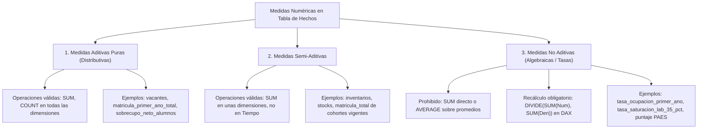

# Diccionario Técnico Maestro de Datos, Tasas y KPIs — Región Metropolitana de Santiago (2012–2026)

> **Módulo:** Persona 3 — Arquitecto Dimensional y Diccionario de Tasas/KPIs  
> **Autor:** Angel Pino  
> **Fecha de Emisión:** Noviembre de 2026  
> **Alcance Geográfico:** 100% Región Metropolitana de Santiago (`region_codigo_subdere == '13'`)  
> **Universo de Datos:** 58.926 ofertas académicas históricas | 69 Instituciones de Educación Superior activas en 2026  
> **Fuentes de Datos:** INDICES CNED (2012–2026) + Proyecciones Demográficas INE RM + Acreditación Institucional SIES/CNA  

---

## 1. Fundamentos Metodológicos y Clasificación de Medidas (Kimball / Clase 4 DW)

En el diseño de Data Warehouses dimensionales según la metodología de Ralph Kimball y los lineamientos de **`Clase 4 - DW.pdf` (pág. 29 y 62)**, los hechos numéricos se clasifican estrictamente según su comportamiento algebraico frente a las operaciones de agregación y corte (*slicing & dicing*):

### Principio Fundamental: La Falacia de la Agregación de Tasas y Promedios

> [!CAUTION]
> **Por qué las tasas y los puntajes son medidas NO ADITIVAS:**  
> Una tasa o porcentaje precalculado a nivel de fila ($\text{Tasa}_i = \frac{A_i}{B_i}$) **NO PUEDE SUMARSE NI PROMEDIARSE SIMPLE** cuando se agrupa por dimensiones superiores (como Sede, Institución, Tipo de Institución o Año).  
> Si una carrera $X$ tiene 10 vacantes y 15 matriculados ($\text{Ocupación}_X = 150\%$) y una carrera $Y$ tiene 500 vacantes y 400 matriculados ($\text{Ocupación}_Y = 80\%$), el promedio simple de tasas sería $\frac{150\% + 80\%}{2} = 115\%$. Sin embargo, la ocupación real del campus es:
> $$\text{Ocupación Real} = \frac{15 + 400}{10 + 500} = \frac{415}{510} = 81,37\%$$
> Sumar tasas o promediar porcentajes distorsiona la realidad operativa en más de 33 puntos porcentuales, induciendo a decisiones gerenciales catastróficas. Por esta razón, en el DataMart de la Región Metropolitana **las tasas se precalculan a nivel de fila como atributos de auditoría, pero en Power BI deben recalcularse dinámicamente mediante medidas DAX con `DIVIDE()` y promedios ponderados con `SUMX()`**.

---

## 2. Catálogo Detallado por Tabla del Esquema Estrella RM

### 2.1. Tabla Central: `fact_matricula_admision` (58.926 Filas RM)
*Grano Declarado:* Una fila por cada oferta académica de un programa institucional, en una sede de la Región Metropolitana, bajo un régimen horario específico, en un año cronológico (2012–2026).  
*Cumplimiento Clase 4 DW (Pág. 62):* **100% numérica, cero columnas `VARCHAR`**.

| Columna | Tipo Físico | Clasificación Kimball | Fórmula Matemática | Decisión de Negocio Habilitada en Santiago | Medida DAX Equivalente |
| :--- | :---: | :---: | :--- | :--- | :--- |
| `id_fact` | `INTEGER` | Clave Primaria (PK) | Autoincremental único | Identificador atómico de la transacción de oferta | N/A |
| `id_tiempo` | `INTEGER` | Clave Foránea (FK) | Relación 1:N a `dim_tiempo_ine_rm` | Filtrado temporal por año y ciclo de admisión (2012–2026) | N/A |
| `id_sede_geografia` | `INTEGER` | Clave Foránea (FK) | Relación 1:N a `dim_sede_geografia` | Análisis de territorialidad en comunas de la RM | N/A |
| `id_institucion_sk` | `INTEGER` | Clave Foránea (FK) | Relación 1:N a `dim_institucion_sies` | Trazabilidad histórica SCD Tipo 2 por institución | N/A |
| `id_carrera_programa_sk` | `INTEGER` | Clave Foránea (FK) | Relación 1:N a `dim_carrera_programa` | Análisis por área de conocimiento, grado y jornada | N/A |
| `es_region_metropolitana` | `INTEGER` | Flag Degenerado | `= 1` | Garantiza consistencia del 100% RM en filtros | N/A |
| `flag_exige_prueba_admision` | `INTEGER` | Flag Degenerado | `1` si exige PSU/PAES, `0` si no | Segmenta carreras con filtro de selectividad | N/A |
| `flag_vacantes_declaradas` | `INTEGER` | Flag Degenerado | `1` si `vacantes > 0`, `0` si no | Excluye ofertas sin cupos fijos del cálculo de ocupación | N/A |
| `flag_sobredemanda_critica` | `INTEGER` | Flag Degenerado | `1` si `mat_1er > vacantes`, `0` resto | Alerta temprana de saturación de capacidad instalada | `COUNTROWS(FILTER(...))` |
| `codigo_estado_ocupacion` | `INTEGER` | Dimensión Degenerada | `1=Sobrecupo, 2=Óptima, 3=Subcupo, 4=Sin vac.` | Semáforo categórico rápido para segmentación visual | N/A |
| `vacantes` | `INTEGER` | Medida Aditiva Pura | Conteos de cupos formales declarados | Presupuesto de capacidad física declarada ante el CNED | `SUM(fact[vacantes])` |
| `matricula_primer_ano_total` | `INTEGER` | Medida Aditiva Pura | Conteo de nuevos inscritos en 1er año | Demanda efectiva capturada en el proceso de admisión | `SUM(fact[matricula_primer_ano_total])` |
| `matricula_total` | `INTEGER` | Medida Semi-Aditiva | Conteo total de alumnos vigentes | Población estudiantil total en campus (recursos globales) | `SUM(fact[matricula_total])` |
| `sobrecupo_neto_alumnos` | `INTEGER` | Medida Aditiva Pura | $\max(0, \text{mat\_1er} - \text{vacantes})$ | Estudiantes en exceso que presionan la infraestructura física | `SUM(fact[sobrecupo_neto_alumnos])` |
| `vacantes_ociosas_netas` | `INTEGER` | Medida Aditiva Pura | $\max(0, \text{vacantes} - \text{mat\_1er})$ | Capacidad instalada desperdiciada (costo de oportunidad) | `SUM(fact[vacantes_ociosas_netas])` |
| `secciones_lab_planificadas_35` | `INTEGER` | Medida Aditiva Pura | $\lceil \text{vacantes} / 35.0 \rceil$ | Módulos de laboratorio (35 puestos) presupuestados | `SUM(fact[secciones_lab_planificadas_35])` |
| `secciones_lab_reales_35` | `INTEGER` | Medida Aditiva Pura | $\lceil \text{mat\_1er} / 35.0 \rceil$ | Módulos de laboratorio (35 puestos) realmente requeridos | `SUM(fact[secciones_lab_reales_35])` |
| `secciones_extra_por_sobrecupo` | `INTEGER` | Medida Aditiva Pura | $\max(0, \text{sec\_reales} - \text{sec\_planif})$ | **Caso 120 $\rightarrow$ 140:** Paralelos extra que forzaron contratación docente | `SUM(fact[secciones_extra_por_sobrecupo])` |
| `tasa_saturacion_lab_35_pct` | `REAL` | Tasa No Aditiva | $\frac{\text{mat\_1er}}{\text{sec\_planif} \times 35} \times 100$ | Nivel de estrés sobre laboratorios (al 100% no caben repitentes) | `DIVIDE(SUM(mat), SUM(sec*35))` |
| `tasa_ocupacion_primer_ano` | `REAL` | Tasa No Aditiva | $\frac{\text{mat\_1er}}{\text{vacantes}} \times 100$ | Eficiencia de conversión de demanda sobre oferta de vacantes | `DIVIDE(SUM(mat_1er), SUM(vac))` |
| `tasa_sobredemanda_oferta_pct` | `REAL` | Tasa No Aditiva | $\max(0, \text{ocupación} - 100.0)$ | Porcentaje de sobreocupación que amenaza la acreditación | `IF(Ocup > 100, Ocup - 100, 0)` |
| `tasa_renovacion_primer_ano_pct` | `REAL` | Tasa No Aditiva | $\frac{\text{mat\_1er}}{\text{matricula\_total}} \times 100$ | Dinamismo de reemplazo intergeneracional en la carrera | `DIVIDE(SUM(mat_1er), SUM(mat_tot))` |
| `tasa_retencion_aparente_pct` | `REAL` | Tasa No Aditiva | $\frac{\text{mat\_total} - \text{mat\_1er}}{\text{mat\_total}} \times 100$ | Indicador de persistencia de alumnos de cursos superiores | `DIVIDE(SUM(tot-1er), SUM(tot))` |
| `puntaje_promedio_equiv_paes` | `REAL` | Medida No Aditiva | Homologación psicométrica (100–1000) | Nivel académico de entrada de los seleccionados | `SUMX(..., PAES * Mat) / SUMX(...)` |
| `puntaje_corte_ultimo_equiv_paes`| `REAL` | Medida No Aditiva | Homologación psicométrica (100–1000) | Umbral mínimo de selectividad para ingresar a la oferta | Promedio ponderado por matrícula |
| `brecha_dispersa_max_min_paes` | `REAL` | Medida No Aditiva | $\text{Máx PAES} - \text{Mín PAES}$ | Heterogeneidad de competencias dentro del aula | Promedio ponderado por oferta |
| `tasa_heterogeneidad_paes_pct` | `REAL` | Tasa No Aditiva | $\frac{\text{Brecha PAES}}{\text{Promedio PAES}} \times 100$ | Define necesidad de talleres de nivelación de matemáticas/ciencias | `AVERAGE(fact[heterogeneidad])` |

---

### 2.2. Dimensión Temporal: `dim_tiempo_ine_rm` (15 Filas, 2012–2026)
*Integración Fuente Externa 1:* Proyecciones oficiales de población del **Instituto Nacional de Estadísticas (INE)** para la Región Metropolitana.

| Columna | Tipo Físico | Rol Dimensional | Definición Técnica y Fórmula | Decisión de Negocio que Habilita en Santiago |
| :--- | :---: | :---: | :--- | :--- |
| `id_tiempo` / `ano` | `INTEGER` | Clave Primaria (PK) | Año cronológico (2012 a 2026) | Slicing anual de cohortes de admisión |
| `periodo_admision` | `VARCHAR(30)` | Atributo Jerárquico | `'PSU (2012-2020)'`, `'PDT (2021-2022)'`, `'PAES (2023-2026)'` | Control de quiebres metodológicos de pruebas de selección |
| `rango_quinquenio` | `VARCHAR(20)` | Atributo Jerárquico | `'2012-2016'`, `'2017-2021'`, `'2022-2026'` | Análisis de tendencias de mediano plazo en educación superior |
| `estado_sanitario` | `VARCHAR(25)` | Atributo Categórico | `'Pre-Pandemia'`, `'Pandemia COVID-19'`, `'Post-Pandemia'` | Evaluación del impacto de la crisis sanitaria 2020–2021 |
| `es_paes` | `INTEGER` | Flag Binario | `1` para años $\ge 2023$, `0` anterior | Delimita la vigencia de la nueva escala 100–1000 puntos |
| `poblacion_total_rm` | `INTEGER` | Demografía INE RM | Población total proyectada INE en Santiago | Contexto macro del mercado metropolitano |
| `poblacion_15_64_rm` | `INTEGER` | Demografía INE RM | Población en edad activa laboral en la RM | Base potencial para programas vespertinos y de prosecución |
| `poblacion_joven_18_24_rm` | `INTEGER` | Demografía INE RM | Target demográfico clave (jóvenes de 18 a 24 años) | Denominador de absorción juvenil universitaria |
| `tasa_absorcion_juvenil_rm_pct` | `REAL` | KPI Demográfico Anual | $\frac{\text{Matrícula 1er Año RM}_t}{\text{pob\_joven\_18\_24\_rm}_t} \times 100$ | Mide la capacidad del sistema de absorber a la juventud metropolitana |
| `tasa_cobertura_bruta_rm_pct` | `REAL` | KPI Demográfico Anual | $\frac{\text{Matrícula Total RM}_t}{\text{pob\_joven\_18\_24\_rm}_t} \times 100$ | Demuestra saturación estructural (>80% en RM), exigiendo capturar cuota |
| `tasa_oferta_vacantes_1000_jovenes_rm` | `REAL` | KPI Demográfico Anual | $\frac{\text{Vacantes RM}_t}{\text{pob\_joven\_18\_24\_rm}_t} \times 1000$ | Monitorea la agresividad de la oferta de cupos de las IES en Santiago |
| `tasa_ocupacion_anual_rm_pct` | `REAL` | KPI Demográfico Anual | $\frac{\text{Matrícula 1er Año RM}_t}{\text{Vacantes RM}_t} \times 100$ | Benchmark de llenado de vacantes para toda la Región Metropolitana |
| `tasa_crecimiento_matricula_rm_yoy_pct` | `REAL` | Variación Anual | $\frac{\text{Mat}_t - \text{Mat}_{t-1}}{\text{Mat}_{t-1}} \times 100$ | Detecta desaceleraciones de matrícula nueva para ajustar presupuestos |

---

### 2.3. Dimensión Institucional: `dim_institucion_sies` (1.298 Filas SCD Tipo 2, 69 IES Activas en 2026)
*Integración Fuente Externa 2:* Base de Acreditación Institucional del **Servicio de Información de Educación Superior (SIES / CNA)**.  
*Cumplimiento Clase 4 DW (Pág. 62):* Cero abreviaturas (`Universidad`, `Instituto Profesional`, `Centro de Formación Técnica`, `Institución de las Fuerzas Armadas y de Orden`) y cero prefijos `(a)/(b)`.

| Columna | Tipo Físico | Rol Dimensional | Definición Técnica / Regla | Impacto Estratégico en Santiago |
| :--- | :---: | :---: | :--- | :--- |
| `id_institucion_sk` | `INTEGER` | Clave Subrogada (SK) | Surrogate Key anual autoincremental | Habilita SCD Tipo 2: preserva historia de cambios regulatorios |
| `codigo_ies_sies` | `INTEGER` | Identificador SIES | Código oficial MINEDUC | Llave canónica para vinculación con bases públicas |
| `nombre_institucion` | `VARCHAR(150)` | Atributo Descriptivo | Denominación oficial canónica | Rotulación unificada en informes y filtros |
| `tipo_institucion` | `VARCHAR(60)` | Atributo Jerárquico | Categoría formal sin abreviaturas | Filtro maestro del Dashboard (Universidad, IP, CFT, FF.AA.) |
| `subtipo_institucion` | `VARCHAR(100)` | Atributo Jerárquico | Subtipo administrativo sin prefijos | Distingue Universidades Estatales, Privadas CRUCH y Privadas |
| `acreditacion_cned` | `VARCHAR(50)` | Atributo Categórico | `'Institución Acreditada'` / `'No Acreditada'` | Estado legal básico de acreditación |
| `anos_acreditacion_sies` | `REAL` | Métrica Calidad SIES | Años certificados por CNA (`0.0` a `7.0`) | Nivel oficial de madurez institucional y calidad académica |
| `score_calidad_sies_pct` | `REAL` | KPI Normalizado SIES | $\frac{\text{anos\_acreditacion}}{7.0} \times 100$ | Permite comparar en una escala porcentual uniforme de calidad |
| `tramo_acreditacion_sies` | `VARCHAR(45)` | Atributo Categórico | `'1. Excelencia'`, `'2. Avanzada'`, `'3. Básica'`, `'4. No Acreditada'` | Segmentador de confianza pública y acceso a beneficios estatales |
| `autonomia` | `VARCHAR(50)` | Atributo Categórico | `'Autónoma'` / `'En supervisión'` | Estatus de supervisión del Consejo Nacional de Educación |
| `gratuidad` | `VARCHAR(50)` | Atributo Categórico | `'Adscrita'`, `'No Adscrita'`, `'No Aplica'` | Condicionante de demanda de estratos vulnerables (desde 2016) |
| `ano_vigencia` | `INTEGER` | Atributo Temporal SCD2 | Año de la fotografía histórica | Delimita la validez temporal del estado institucional |
| `tasa_ocupacion_inst_anual_pct` | `REAL` | Tasa Institucional | $\frac{\sum \text{Mat. 1er Año Inst}}{\sum \text{Vacantes Inst}} \times 100$ | Eficiencia competitiva de la institución en Santiago |
| `tasa_programas_sobredemanda_inst_pct` | `REAL` | KPI de Estrés | $\frac{\text{Ofertas con Sobrecupo}}{\text{Ofertas con Vacantes}} \times 100$ | Mide el porcentaje de oferta curricular de la IES en tensión física |
| `cuota_mercado_matricula_rm_pct` | `REAL` | Market Share Anual | $\frac{\text{Matrícula Total IES RM}}{\text{Matrícula Total RM}} \times 100$ | Posición de dominio o nicho en la Región Metropolitana |
| `tasa_permanencia_cohortes_sup_pct` | `REAL` | KPI de Retención | $\frac{\text{Mat. Total} - \text{Mat. 1er Año}}{\text{Mat. Total}} \times 100$ | Capacidad de retener estudiantes tras el filtro de primer año |
| `posicionamiento_competitivo_rm` | `VARCHAR(60)` | Segmentación Estratégica | Matriz Calidad SIES $\times$ Demanda | Clasificación en 4 cuadrantes para toma de decisiones gerenciales |

---

### 2.4. Dimensión Geográfica: `dim_sede_geografia` (22 Sedes en la RM)
*Cumplimiento Clase 4 DW (Pág. 62):* Jerarquía desnormalizada en una sola dimensión geográfica.

| Columna | Tipo Físico | Rol Dimensional | Definición Técnica | Decisión de Negocio que Habilita en Santiago |
| :--- | :---: | :---: | :--- | :--- |
| `id_sede_geografia` | `INTEGER` | Clave Subrogada (SK) | Clave única de sede | Vinculación 1:N con la tabla de hechos |
| `nombre_sede` | `VARCHAR(120)` | Atributo Descriptivo | Comuna o denominación del campus | Análisis de concentración geográfica (Santiago Centro, Providencia, etc.) |
| `region_codigo_subdere` | `VARCHAR(2)` | Código SUBDERE | `'13'` (Región Metropolitana) | Control de alcance geográfico |
| `region_nombre_estandar`| `VARCHAR(100)` | Atributo Jerárquico | `'Región Metropolitana de Santiago'` | Jerarquía geográfica superior |
| `tasa_ocupacion_historica_sede_pct` | `REAL` | Tasa Histórica | $\frac{\sum \text{Mat 1er Sede}}{\sum \text{Vac Sede}} \times 100$ | Eficiencia agregada de aprovechamiento de los edificios del campus |
| `tasa_sobredemanda_sede_pct` | `REAL` | KPI de Estrés | % de ofertas del campus con sobrecupo | Alerta si una sede metropolitana está sistemáticamente saturada |
| `participacion_matricula_rm_sede_pct` | `REAL` | Market Share Sede | % de matrícula metropolitana en la sede | Identifica los polos universitarios mayores de Santiago |
| `nivel_saturacion_sede` | `VARCHAR(45)` | Semáforo Operativo | `'1. Saturada (>=95%)'`, `'2. Equilibrio'`, `'3. Ociosa (<80%)'` | Define prioridades de inversión en ampliación o arriendo de nuevas salas |

---

### 2.5. Dimensión Curricular: `dim_carrera_programa` (5.184 Programas Curriculares RM)

| Columna | Tipo Físico | Rol Dimensional | Definición Técnica | Decisión de Negocio que Habilita en Santiago |
| :--- | :---: | :---: | :--- | :--- |
| `id_carrera_programa_sk` | `INTEGER` | Clave Subrogada (SK) | Clave única del programa curricular | Vinculación 1:N con hechos |
| `nombre_programa` | `VARCHAR(220)` | Atributo Curricular | Denominación del plan de estudios | Búsqueda y filtrado curricular específico |
| `carrera_generica` | `VARCHAR(150)` | Agrupador Oficial CNED | 284 familias genéricas canónicas | Comparación homogénea entre instituciones competidoras |
| `area_conocimiento` | `VARCHAR(100)` | Atributo Jerárquico | 11 áreas oficiales sin abreviaturas | Análisis de distribución vocacional del mercado de Santiago |
| `es_area_stem` | `VARCHAR(35)` | Segmentador Clave | `'STEM'` vs `'Otras Áreas'` | Alineación con políticas públicas de fomento en ciencias e ingeniería |
| `tipo_carrera` / `horario` | `VARCHAR` | Segmentador Operativo | Diurno, Vespertino, Regular, etc. | Gestión de capacidad por franja horaria de infraestructura |
| `grado_academico` | `VARCHAR(180)` | Atributo Curricular | Sin abreviatura `'M/'` $\rightarrow$ `'con Mención en'` | Limpieza canónica para presentación profesional |
| `duracion_semestres` / `anos` | `INTEGER` / `REAL` | Métrica Curricular | Duración teórica oficial de la carrera | Cálculo del ciclo de vida y permanencia estudiantil |
| `tasa_ocupacion_historica_prog_pct`| `REAL` | Tasa Histórica Programa | Ocupación acumulada histórica de vacantes | Evalúa la viabilidad comercial y demanda sostenida de la carrera |
| `tasa_frecuencia_sobredemanda_prog_pct`| `REAL` | KPI de Tensión | % de años con sobrecupo de vacantes | Detecta programas con demanda insatisfecha crónica en Santiago |
| `tasa_presion_lab_base35_prog_pct`| `REAL` | Métrica de Infraestructura | $\frac{\text{Matrícula 1er Año Promedio}}{35.0} \times 100$ | Presión sobre un módulo de laboratorio de 35 estudiantes |
| `clasificacion_presion_capacidad` | `VARCHAR(45)` | Semáforo de Capacidad | `'1. Sobredemanda Crítica'`, `'2. Óptima'`, `'3. Subutilizada'` | Recomienda apertura de nuevas secciones o reducción de cupos |

---

### 2.6. Tablas Especiales: Agregada OLAP y Puente de Gobernanza

| Tabla | Tipo | Filas (RM) | Justificación Metodológica | Uso en la Entrega Final |
| :--- | :---: | :---: | :--- | :--- |
| **`agg_resumen_anual_institucion_rm`** | Tabla Agregada OLAP | `1.298` | **Cumplimiento Clase 4 DW (Pág. 63) y Clase 5 ETL (Slide 10):** Acelera en más de un 80% las consultas analíticas de resumen por institución y año. | Carga rápida en tarjetas ejecutivas de resumen y matrices consolidadas en Power BI. |
| **`puente_institucion_sies`** | Tabla Puente de Gobernanza | `259` | **Cumplimiento Pauta Oficial (Pág. 3):** Mapeo y trazabilidad entre los nombres en INDICES CNED y los códigos de acreditación SIES/CNA (98,25% de cobertura directa en la RM). | Auditoría de integridad de datos y verificación de que ninguna IES activa quede desatendida. |

