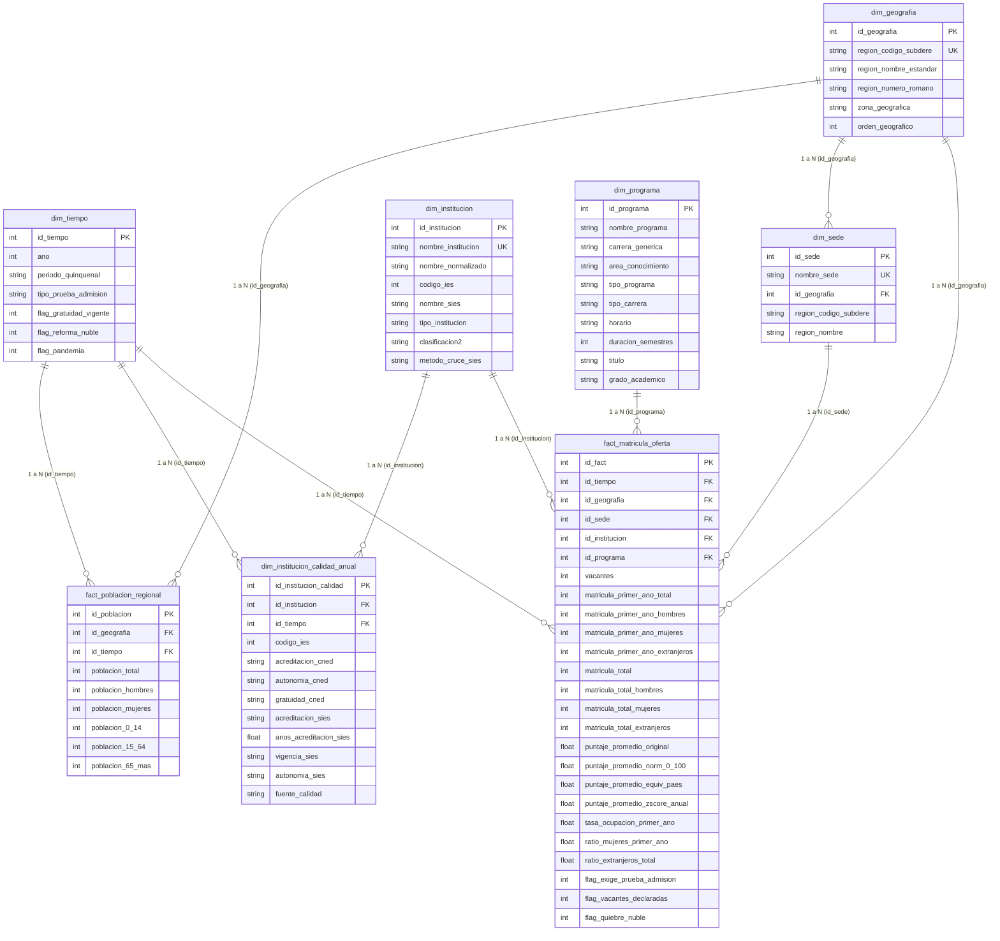

# Arquitectura del Modelo Dimensional - Hito 2
## Rol: Persona 3 (Arquitecto de Bases de Datos)
**Proyecto:** Análisis de Demanda, Capacidad y Equidad Territorial en la Educación Superior Chilena (2012–2026)  
**Esquema:** Constelación de Hechos (Fact Constellation) con Dimensiones Conformadas

---

### 1. Diagrama Entidad-Relación Dimensional (Mermaid)

---

### 2. Jerarquías de Análisis para Power BI (Persona 4)

1. **Jerarquía Geográfica:**
   `Zona Geográfica` $\rightarrow$ `Región` (`region_nombre_estandar`) $\rightarrow$ `Sede` (`nombre_sede`).
2. **Jerarquía Institucional:**
   `Tipo de Institución` (Univ, IP, CFT) $\rightarrow$ `Clasificación2` (CRUCH, Privada) $\rightarrow$ `Institución` (`nombre_institucion`).
3. **Jerarquía Académica:**
   `Área de Conocimiento` $\rightarrow$ `Carrera Genérica` $\rightarrow$ `Nombre Programa` $\rightarrow$ `Horario`.
4. **Jerarquía Temporal:**
   `Período Quinquenal` $\rightarrow$ `Año Calendario`.
